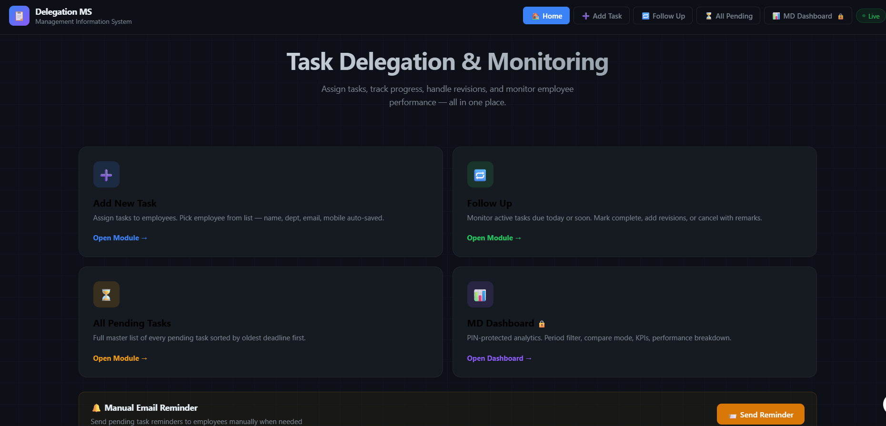
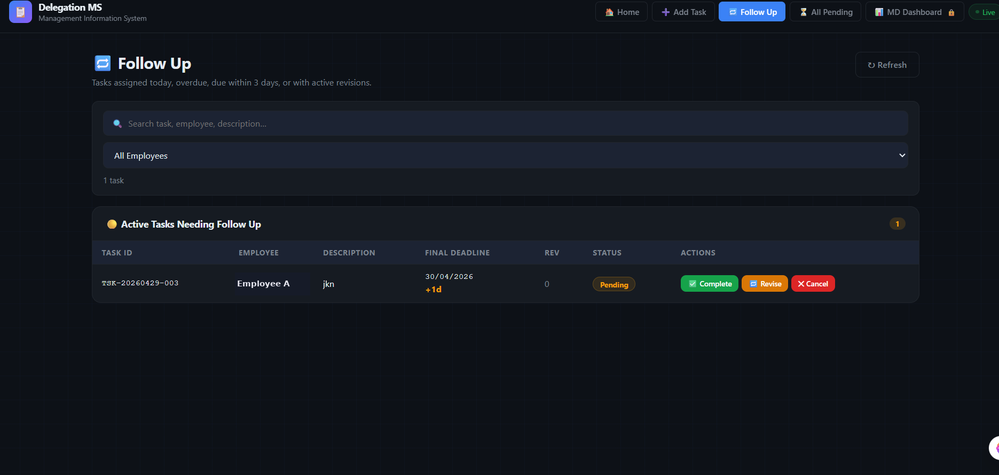
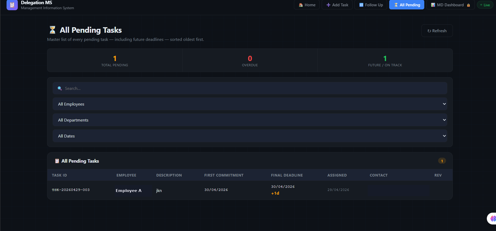
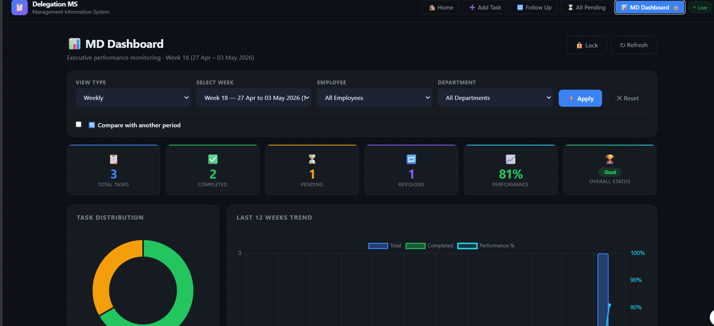
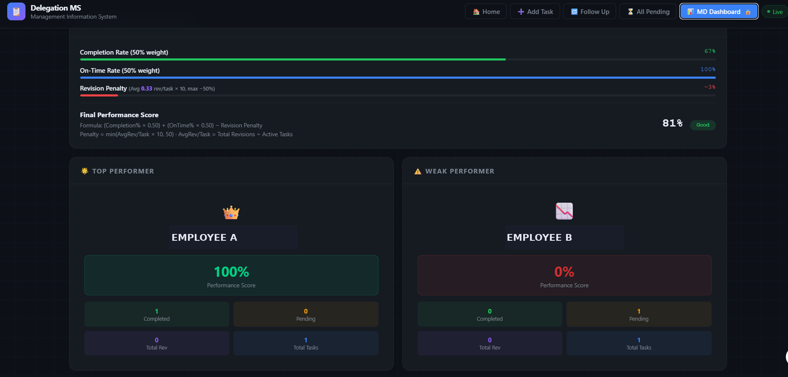

<div align="center">

# 📋 Delegation Management System

**A Google Apps Script web app to assign tasks, track follow-ups and revisions, and score employee performance, with Google Sheets as the database.**




</div>

---

## 📌 Overview

A manager assigns a task, the employee commits to a date, and then the follow-up starts: is it done, was the deadline revised, how often? This app keeps that whole loop in one place. Tasks live in Google Sheets, the team works in a custom web UI, and the MD gets a live dashboard with a transparent performance score. No paid services and no external backend.

## ✨ Features

| Module | What it does |
|---|---|
| ➕ **Add Task** | Assign a task with a first-commitment date; employee name, department, email and mobile auto-fill from the Employee Master |
| 🔁 **Follow Up** | Tasks assigned today, overdue, due within 3 days or under revision; mark Complete, Revise or Cancel with remarks |
| ⏳ **All Pending** | Master list of every pending task, oldest deadline first, with totals for pending, overdue and on-track |
| 📊 **MD Dashboard** | PIN-protected; daily, weekly, monthly or custom-range views, employee and department filters, compare with another period, KPI cards, task distribution and a 12-week trend |
| 🏆 **Performance** | Per-employee score, top and weak performer, revision penalty breakdown |
| 📧 **Email Reminders** | Send pending-task reminders to employees from the app |
| 🗄️ **Archive & Employee Master** | Archive completed tasks; add and edit employee records |

### Performance score

```
Performance % = (Completion% × 0.5) + (OnTime% × 0.5) − RevisionPenalty
RevisionPenalty = min(avgRevisions × 10, 50)
avgRevisions    = totalRevisions ÷ activeTasks
```

## 🖼️ Screenshots

| Follow Up | All Pending |
|---|---|
|  |  |

| MD Dashboard | Performance Score |
|---|---|
|  |  |

*Screenshots use test data (Employee A / Employee B).*

## 🛠️ Tech Stack

| Layer | Technology |
|---|---|
| Backend | Google Apps Script (JavaScript) |
| Frontend | HTML, CSS, JavaScript (single page) |
| Database | Google Sheets: `MASTER`, `EMPLOYEE MASTER`, `ARCHIVE` |
| Charts | Chart.js 4.4 |
| Email | Apps Script `MailApp` |
| Hosting | Apps Script web app (no server) |

## 🗄️ Sheet Structure

**MASTER**

| Col | Field | Col | Field |
|---|---|---|---|
| A | Task ID | I | First Commitment |
| B | Assign Date | J | Expected Completion *(legacy)* |
| C | Emp ID | K | Revision Date 1 |
| D | Emp Name | L | Revision Date 2 |
| E | Department | M | Completion Date |
| F | Email | N | Revision Count |
| G | Mobile | O | Status |
| H | Task Description | P | Remarks |

**EMPLOYEE MASTER:** `EMP ID · NAME · DEPARTMENT · MOBILE · EMAIL`

## 💡 Design Decisions

**Why Google Apps Script?** The goal was zero infrastructure cost and no external dependencies. Apps Script runs on Google's servers, uses Sheets as the database and deploys as a web app, all free.

**Why store dates as Date objects?** Google Sheets reads text dates like `01/05/2026` differently depending on locale. Storing real `Date` objects avoids the silent day/month swap, and `parseDate` only accepts unambiguous formats (`dd/MM/yyyy`, `yyyy-MM-dd`).

**Why average revisions, not total?** Total revisions would punish people with more tasks. Someone with 10 tasks and 2 revisions is doing better than someone with 2 tasks and 2 revisions. Averaging per active task adjusts for workload, and the penalty is capped at 50% so one outlier can't zero a score.

## 📁 Repository Structure

```
task-delegation-tracker/
├── src/
│   ├── Code.gs        # backend: sheet operations, metrics, reminders
│   └── Index.html     # frontend: UI, styles, charts, client-side JS
├── images/            # screenshots used in this README
└── README.md
```

`Code.gs` runs on Google's servers; `Index.html` is served as the web app and calls the backend with `google.script.run`.

## 🚀 How to Deploy

1. Open [script.google.com](https://script.google.com) and create a **New project**.
2. Paste `src/Code.gs` into the default `Code.gs` file.
3. Add an HTML file named `Index` and paste `src/Index.html`.
4. **Deploy → New deployment → Web app**. Execute as **Me**; access for your organisation (or Anyone).
5. Open the web app URL. The `MASTER`, `EMPLOYEE MASTER` and `ARCHIVE` sheets are created on first run.

---

## 👤 Author

**Abhishek Kumar** · MIS Data Analyst  
[LinkedIn](https://www.linkedin.com/in/abhikumar8762/) · [GitHub](https://github.com/abhishek8762a) · [Portfolio](https://abhishek-portfolio-8762.vercel.app) · [Email](mailto:abhiyadav8762@gmail.com)
